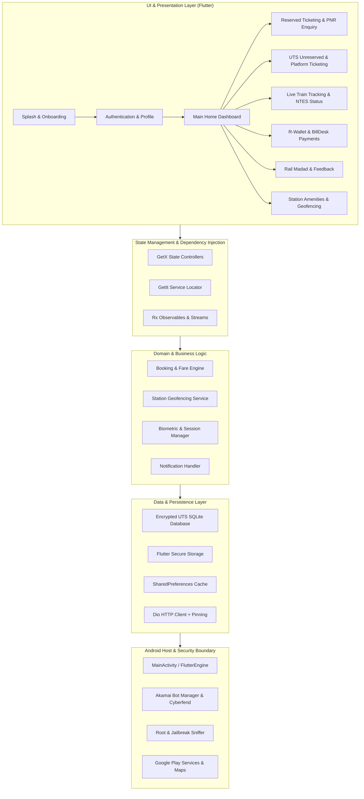

# Technical Architecture Analysis

## 1. Architecture Overview

The reference application **RailOne** (Internal codename: **Aikyam**, Package: `org.cris.aikyam`) is designed as an all-in-one "Super App" for the Indian Railways passenger and freight ecosystem. It consolidates multiple disparate Indian Railway services (IRCTC ticketing, UTS unreserved ticketing, National Train Enquiry System / NTES, Rail Madad, FOIS freight, and IRCTC eCatering) into a single cohesive mobile client.

### Architectural Diagram

---

## 2. Core Architectural Pillars

### 2.1 Application Initialization & Lifecycle
1. **Host Bootstrapping (`AikyamApplication`):**
   - Implements `androidx.core.app.CoreComponentFactory`.
   - Injects `com.emrys.rjsniffer.rjsniffer.AppZygotePreload` during process zygote initialization to run early kernel/root detection before the application sandbox initializes.
   - Initializes Akamai Bot Manager via `CYFWebViewInitProvider` and `SoLibraryInitProvider` on isolated process `:com.akamai.webview.process`.
   - Initializes Firebase, Crashlytics, and WorkManager via `androidx.startup.InitializationProvider`.
2. **Flutter Engine Binding (`MainActivity`):**
   - Configured with `flutterEmbedding = 2` and theme `@style/NormalTheme`.
   - Launches `io.flutter.plugins.GeneratedPluginRegistrant` which binds native platform channels:
     - `com.railone.telsdk.bridge.TelSdkFlutterBridge` (Telecom / SIM authentication SDK)
     - `com.example.aikyam.native.ProtectNative` (Native code obfuscation and signature verification)
     - `com.pichillilorenzo.flutter_inappwebview_android.InAppWebViewFlutterPlugin`
     - `com.baseflow.geolocator.GeolocatorLocationService`
     - `dev.fluttercommunity.plus.share`
     - `net.nfet.flutter.printing`

### 2.2 Navigation Architecture
- **Framework:** Named declarative routing via GetX (`Get.toNamed()`, `GetPage`) alongside Flutter Navigator 2.0.
- **Deep Link Handling:** Intent filters configured for:
  - Food delivery partner callbacks: `zomato://`, `swiggy://`, `fot://`
  - Payment UPI callbacks: `upi://`
- **Navigation Structure:**
  - **Level 1: Splash & Language Selection** (`selectLanguage` modal: English / Hindi).
  - **Level 2: Authentication / Guest Access** (Login, Register, OTP verification, Slide-to-login).
  - **Level 3: Home Dashboard with Bottom Navigation Bar:**
    1. *Home / Services* (Grid of core modules, search card, R-Wallet badge, carousel banners).
    2. *My Bookings / Transactions* (Upcoming journeys, historical tickets, cancelled tickets).
    3. *Enquiry / NTES* (PNR status, Spot your train, Train schedule, Coach position).
    4. *Help / Rail Madad* (Complaint registration, grievance tracking, web claim).
    5. *Profile & Settings* (User credentials, language toggle, linked Aadhaar, biometric toggle).

### 2.3 State Management & Dependency Injection
- **Primary Framework:** `get` (GetX) combined with `get_it`.
- **Pattern:** Reactive state management (`RxBool`, `RxString`, `RxList`, `Obx(() => ...)`).
- **Controllers:**
  - `AuthController`: Handles credentials, OTP countdowns, token refresh, biometric authentication.
  - `WalletController`: Manages R-Wallet balance, transaction history, BillDesk recharge.
  - `TrainSearchController`: Handles station autocomplete, date selection, quota selection, train search results.
  - `PnrController`: Validates 10-digit PNR, queries NTES, formats passenger booking/charting status.
  - `UtsBookingController`: Manages station geofencing, journey/season/platform ticket generation, paperless validation.
  - `MadadController`: Handles grievance submission, image attachment (`ucrop`), complaint tracking.

### 2.4 Networking Architecture
- **HTTP Client:** `dio` with custom interceptors (`cookie_jar` for session maintenance).
- **Security & Pinning:**
  - Implements `http_certificate_pinning` using bundled certificates:
    - `assets/certificates/root_uts.pem`
    - `assets/certificates/inter_uts.pem`
  - Validates CRIS server certificates to prevent MitM interception.
- **Bot Defense Header Integration:**
  - Interceptors inject Akamai Sensor Data telemetry generated by `com.cyberfend.cyfsecurity`.
  - Anti-replay nonces and cryptographic HMAC request signing in `ProtectNative`.

### 2.5 Local Storage & Database Architecture
1. **Encrypted SQLite (`sqflite_sqlcipher`):**
   - The reference APK ships with a pre-populated 7.1 MB database: `assets/sqlitedb/UTSDb.sqlite`.
   - Encrypted with SQLCipher (256-bit AES encryption) using a key derived from native code and application parameters.
   - Contains station codes, station names in English and Hindi, inter-station distances, suburban railway zone mappings, fare calculation matrices, and route tables.
2. **Encrypted Key-Value Storage (`flutter_secure_storage`):**
   - Stores JWT access tokens, refresh tokens, biometric keys, and device UUID in the Android Keystore (`androidx.security.crypto.EncryptedSharedPreferences`).
3. **Application Preferences (`shared_preferences`):**
   - Stores non-sensitive settings: selected language (`en`/`hi`), theme preference, recent search history, onboarding flag.

### 2.6 Hardware & Native Integrations
- **Geofencing & Location (`geolocator`, `geodesy`, `latlong2`):**
  - Essential for UTS paperless ticketing: prevents ticket purchase while physically inside the train or on station tracks (anti-fraud rule).
  - Matches user GPS coordinates against bundled polygon KML files (`Ahmedabad.kml`, `Delhi.kml`, `Lucknow.kml`, etc.).
- **Camera & Barcode Scanning (`mobile_scanner`, ML Kit Vision):**
  - Scans QR codes at station ticket counters and UTS kiosks.
- **Biometrics (`local_auth` / `USE_BIOMETRIC`):**
  - Fingerprint and Face Unlock authentication for instant login without typing passwords.
- **Printing & Ticket Export (`printing`, `pdfx`):**
  - Generates downloadable and printable PDF tickets (`IRCTC_ERS`, UTS ticket receipts).

---

## 3. Resilience, Error Handling & Logging

1. **Connectivity Detection:** Uses `internet_connection_checker_plus` and `connectivity_plus` to display instant offline banners and prevent broken API invocations.
2. **Crash & Telemetry Reporting:** Firebase Crashlytics, Firebase Performance Monitoring, and Matomo Analytics (`matomo_tracker`).
3. **Screen Protection:** `no_screenshot` prevents unauthorized screenshot capture and screen recording during active ticket inspection screens.

