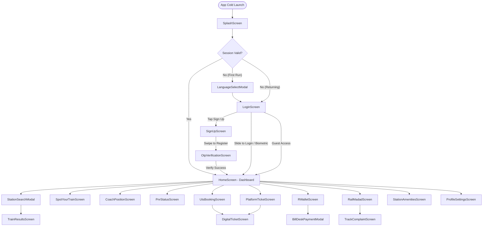

# User Flows & End-to-End Passenger Journeys

## 1. Overview

This document maps the primary user journeys and decision workflows within the **RailOne** (`org.cris.aikyam`) application. Each flow documents the trigger, sequential step-by-step actions, validation gates, system responses, state updates, and error fallback paths.

---

## 2. Core User Journey Flowcharts

### 2.1 Complete Application Navigation Tree

---

## 3. Detailed Journey Specifications

---

### Journey 01: Onboarding, Language Selection & Guest Access
- **Primary Persona:** First-time user opening the app without credentials.
- **Workflow Steps:**
  1. User launches RailOne APK.
  2. `SplashScreen` runs integrity and security checks via `AppZygotePreload`.
  3. `LanguageSelectModal` opens displaying English ("English") and Hindi ("हिंदी").
  4. User taps preferred language -> Application locale instantly updates across all strings via `Get.updateLocale()`.
  5. User taps "Continue".
  6. `LoginScreen` appears.
  7. User taps "Skip / Guest Access" in top-right corner.
  8. User lands on `HomeScreen` with full inquiry access (PNR, Spot Train, Coach Position, Schedules).
- **Validation Gates:** Pinned certificate check; root integrity check.
- **Fallback / Error Path:** If device fails root/tamper check, app presents security advisory and terminates.

---

### Journey 02: New User Registration & 6-Digit OTP Verification
- **Primary Persona:** Unregistered passenger creating a RailOne identity.
- **Workflow Steps:**
  1. User taps "Sign up" on `LoginScreen`.
  2. `SignUpScreen` opens.
  3. User enters Full Name, Mobile Number (+91), Email ID, and Password.
  4. Live password checklist validates characters in real-time:
     - Upper, lower, number, special char, 8 chars minimum.
  5. Once all 5 checkmarks turn green, the "Slide to sign up" slider unlocks.
  6. User swipes slider to the right.
  7. Backend issues 6-digit SMS and Email OTP; app transitions to `OtpVerificationScreen`.
  8. `sms_autofill` captures SMS OTP or user types into the 6 square boxes.
  9. User taps "Verify".
  10. Account is created, user session token is saved in `flutter_secure_storage`, and app routes to `HomeScreen`.
- **Validation Gates:** Mobile number length (10 digits); Email format regex; OTP expiry timer (120s).
- **Fallback / Error Path:** If OTP incorrect, boxes highlight red with shake animation; user can tap "Resend OTP" after 30s cooldown.

---

### Journey 03: Password & Biometric Instant Login
- **Primary Persona:** Returning passenger with saved credentials.
- **Workflow Steps:**
  1. User opens app -> `LoginScreen`.
  2. If Biometrics enabled: Fingerprint/Face prompt appears automatically.
  3. User touches fingerprint sensor -> Biometric signature decrypts access token from Android Keystore -> Instant entry to `HomeScreen`.
  4. Alternative flow: User enters User ID and Password -> Swipes "Slide to Login" -> Authenticates via CRIS Gateway -> Entry to `HomeScreen`.
- **Validation Gates:** Biometric hardware authentication; server credential check.
- **Fallback / Error Path:** If biometric fails 3 times, OS falls back to Password entry; "Forgot Password" sends reset OTP to registered mobile.

---

### Journey 04: Train Search & Live Berth Availability
- **Primary Persona:** Passenger planning an intercity train journey.
- **Workflow Steps:**
  1. On `HomeScreen`, user taps "From: Origin Station?".
  2. `StationSearchModal` opens; user types "NDLS" or "Delhi"; selects "New Delhi (NDLS)".
  3. User taps "To: Where To?"; selects "Mumbai Central (BCT)".
  4. User taps Date tile; picks journey date from calendar.
  5. (Optional) User taps station swap icon (`swap_icon.png`) to reverse direction.
  6. User taps "Search Trains".
  7. `TrainResultsScreen` displays list of scheduled trains (Rajdhani, August Kranti, Tejas).
  8. User selects Quota (General / Tatkal) and taps class chip (`3A`).
  9. App fetches live berth count (`AVAILABLE 45` or `WL 24`) and ticket fare.
- **Validation Gates:** Origin and destination cannot be identical; journey date cannot be in the past (up to 120 days in advance).
- **Fallback / Error Path:** If no direct trains exist, app offers connecting trains or alternate origin/destination stations in the same city cluster.

---

### Journey 05: Live Train Tracking ("Spot Your Train")
- **Primary Persona:** Passenger tracking train location, delay, and arrival platform.
- **Workflow Steps:**
  1. On `HomeScreen`, user taps "Spot Your Train" (`enquire_spot_your_train.png`).
  2. User enters 5-digit train number (e.g., `12952`) or selects from recent trains.
  3. `SpotYourTrainScreen` opens.
  4. Top banner indicates real-time delay: "Delayed by 12 mins • Arriving Ratlam Jn Platform 4".
  5. User scrolls down vertical timeline to inspect passed stations, current live GPS position (pulsing train icon), and remaining stations.
  6. User taps "Refresh" to pull the latest NTES feed.
  7. User taps "Share" to send WhatsApp/SMS update to family.
- **Validation Gates:** 5-digit train number validation; valid running day check.
- **Fallback / Error Path:** If GPS feed is interrupted, app displays timestamp of last reported physical station crossing.

---

### Journey 06: Coach Position & Boarding Alignment
- **Primary Persona:** Passenger standing on station platform preparing to board.
- **Workflow Steps:**
  1. User taps "Coach Position" on `HomeScreen`.
  2. User enters Train Number or PNR.
  3. `CoachPositionScreen` opens displaying the full rake composition on a horizontal track:
     `[Engine] [Power] [H1] [A1] [A2] [B1] [B2] [B3] [PC] [S1] ... [Guard]`
  4. User scrolls horizontally to locate their coach (e.g. `B2`).
  5. User taps coach `B2` -> Card expands to show berth layout map (1 to 72: Lower, Middle, Upper, Side Lower, Side Upper).
  6. User taps "Flip Direction" if train reverses at this junction.
- **Validation Gates:** Valid train rake record in schedule database.
- **Fallback / Error Path:** If rake composition is unannounced, app shows standard rake for that train type with an "Unconfirmed formation" badge.

---

### Journey 07: 10-Digit PNR Status & Charting Enquiry
- **Primary Persona:** Passenger with a waitlisted or RAC ticket checking confirmation.
- **Workflow Steps:**
  1. User taps "PNR Status" on `HomeScreen`.
  2. User enters 10-digit PNR in `PnrStatusScreen`.
  3. User taps "Check Status".
  4. App queries NTES gateway and returns:
     - Top banner: "Chart Prepared" (Green) or "Chart Not Prepared" (Orange).
     - Journey details: Train No/Name, Date, Boarding point.
     - Passenger Table:
       - Passenger 1: Booking Status `B2, 45, MB` -> Current Status `CNF`.
       - Passenger 2: Booking Status `WL 12` -> Current Status `RAC 4`.
  5. User taps "Download E-Ticket" or "Order Food on Train".
- **Validation Gates:** Exactly 10 numeric digits; Modulo-10 checksum check.
- **Fallback / Error Path:** "PNR does not exist / Flushed from database" if journey completed over 5 days ago.

---

### Journey 08: UTS Paperless Suburban Journey Ticket Booking
- **Primary Persona:** Commuter booking an unreserved local/suburban train ticket on mobile.
- **Workflow Steps:**
  1. User taps "UTS Unreserved Ticket" on `HomeScreen`.
  2. `UtsBookingScreen` launches and requests GPS location.
  3. **Geofencing Check:**
     - App verifies device is within 5.0 km of source station.
     - App checks coordinates against bundled polygon KML (`Ahmedabad.kml`, `Delhi.kml`, etc.) to ensure user is outside station tracks.
  4. Destination station selected; Passenger count picked (e.g. 2 Adults); Class: Second Class (`II`).
  5. App calculates fare (`₹ 30.00`).
  6. User taps "Book Ticket" with "R-Wallet" selected.
  7. R-Wallet debited ₹30.00; cryptographic ticket receipt generated.
  8. `DigitalTicketScreen` opens immediately displaying the active ticket with animated anti-tamper watermark, 2D barcode, and inspection QR code.
- **Validation Gates:**
  - GPS enabled (`ACCESS_FINE_LOCATION`).
  - Outside track boundary (Geofence rule).
  - Sufficient R-Wallet balance.
- **Fallback / Error Path:** If user is inside station track area, system blocks booking: "Paperless tickets cannot be booked inside station premises. Please use ticket counter or kiosk."

---

### Journey 09: Platform Ticket One-Tap Booking
- **Primary Persona:** Visitor dropping off family at railway station.
- **Workflow Steps:**
  1. User taps "Platform Ticket" on `HomeScreen`.
  2. `PlatformTicketScreen` auto-detects nearest railway station (e.g., "NDLS").
  3. User selects number of visitors (e.g., `1 Person` -> `₹ 10.00`).
  4. User taps "One-Tap Book via R-Wallet".
  5. `DigitalTicketScreen` opens displaying 2-hour validity countdown timer (`Valid till 14:30`) and QR code.
- **Validation Gates:** GPS station detection; 2-hour max validity period.
- **Fallback / Error Path:** If R-Wallet balance < ₹10.00, app prompts instant BillDesk top-up modal.

---

### Journey 10: R-Wallet Balance Recharge via BillDesk
- **Primary Persona:** Passenger adding money to R-Wallet to enjoy 3% bonus cashback.
- **Workflow Steps:**
  1. User taps "R-Wallet" on `HomeScreen` or "Add money now" badge.
  2. `RWalletScreen` opens showing current balance: `₹ 2.00`.
  3. User taps quick recharge chip `+ ₹ 500`.
  4. App highlights: "You will receive ₹515.00 (3% Railway Cashback Bonus)".
  5. User taps "Proceed to Pay".
  6. `BillDeskPaymentModal` opens.
  7. User selects preferred payment method:
     - UPI (Google Pay, PhonePe, Paytm, BHIM).
     - Debit / Credit Card (RuPay, Visa, Mastercard).
     - NetBanking (SBI, HDFC, ICICI, PNB).
  8. User completes payment in bank interface.
  9. Callback returns to app; animated `Confetti.gif` and `icons8-success.gif` display: "Recharge Successful! New Balance: ₹ 517.00".
- **Validation Gates:** Minimum recharge ₹100; maximum wallet balance ₹10,000.
- **Fallback / Error Path:** If bank declines transaction, modal shows clear error message with auto-refund guarantee notice.

---

### Journey 11: Food on Train (IRCTC eCatering & Deep Links)
- **Primary Persona:** Passenger ordering hot meals to their train seat.
- **Workflow Steps:**
  1. User taps "Food On Train" on `HomeScreen`.
  2. User enters 10-digit PNR or Train Number.
  3. App retrieves train itinerary and upcoming meal-stop stations.
  4. App offers choice:
     - Browse IRCTC eCatering menu inside embedded WebView (`WavesActivity`).
     - Launch food partner deep links: Swiggy (`swiggy://`), Zomato (`zomato://`), Food on Track (`fot://`).
  5. Meal delivered to passenger's seat at selected station.
- **Validation Gates:** Confirmed or RAC PNR; station must have authorized catering vendors.
- **Fallback / Error Path:** If partner app is not installed, deep link falls back to opening the partner website via `InAppBrowserActivity`.

---

### Journey 12: Rail Madad Complaint Lodging & Live Tracking
- **Primary Persona:** Passenger reporting cleanliness, electrical, or security issues during a journey.
- **Workflow Steps:**
  1. User taps "Rail Madad" on bottom navigation bar.
  2. `RailMadadScreen` opens.
  3. User selects "Train Complaint" -> enters PNR `2451892019`.
  4. User picks Category: "Cleanliness" -> Sub-category: "Coach Washroom Unclean".
  5. User taps "Attach Photo"; takes picture with camera; image is cropped via `UCropActivity` and compressed.
  6. User types description: "Washroom in coach B2 requires cleaning".
  7. User taps "Submit Grievance".
  8. Grievance Reference Number generated (e.g., `RM-2026-11-098231`); SMS notification sent.
  9. User navigates to `TrackComplaintScreen` to observe progress stepper:
     - `Registered` -> `Assigned to On-Duty Staff` -> `Action Taken` -> `Resolved`.
  10. Once resolved, user selects satisfaction face icon (`coloured_good_icon.svg.vec`).
- **Validation Gates:** PNR or Station Code required; photo attachment size limit 5 MB.
- **Fallback / Error Path:** Emergency SOS button on top dials Railway Helpline 139 directly.

---

### Journey 13: Station Amenities Discovery ("Know Your Station")
- **Primary Persona:** Passenger navigating a large railway station junction.
- **Workflow Steps:**
  1. User taps "Station Amenities" / "Know Your Station" on `HomeScreen`.
  2. `StationAmenitiesScreen` opens; user enters station code `NDLS`.
  3. Categorical amenity cards display:
     - Drinking water booths (Platforms 1 to 16).
     - Waiting halls (Executive lounge, AC Waiting Hall on Platform 1 & 16).
     - Restrooms, Lifts, Escalators, Foot Over Bridges.
     - Food plazas (Comsom Food Plaza Platform 1).
     - Retiring room bookings.
  4. User taps an amenity to view exact platform and FOB navigation notes.
- **Validation Gates:** Valid station code.
- **Fallback / Error Path:** "Amenity data not yet mapped for this rural station."

---

### Journey 14: Profile Management, Aadhaar KYC & Biometrics
- **Primary Persona:** User updating security settings and verifying identity.
- **Workflow Steps:**
  1. User taps Profile icon on `HomeScreen` top bar.
  2. `ProfileSettingsScreen` opens showing passenger name, mobile, and email.
  3. User taps "Link Aadhaar" -> Completes OTP verification with UIDAI to gain higher monthly ticket booking quota (up to 24 tickets/month).
  4. User enables "Biometric Login" switch.
  5. OS Biometric sensor prompts fingerprint/face confirmation.
  6. Biometric credential hash stored securely in `flutter_secure_storage`.
  7. Future app launches authenticate immediately with zero typing.
- **Validation Gates:** UIDAI Aadhaar OTP validation; hardware biometric support check.
- **Fallback / Error Path:** Biometric toggle disabled if device lacks fingerprint/face hardware.

